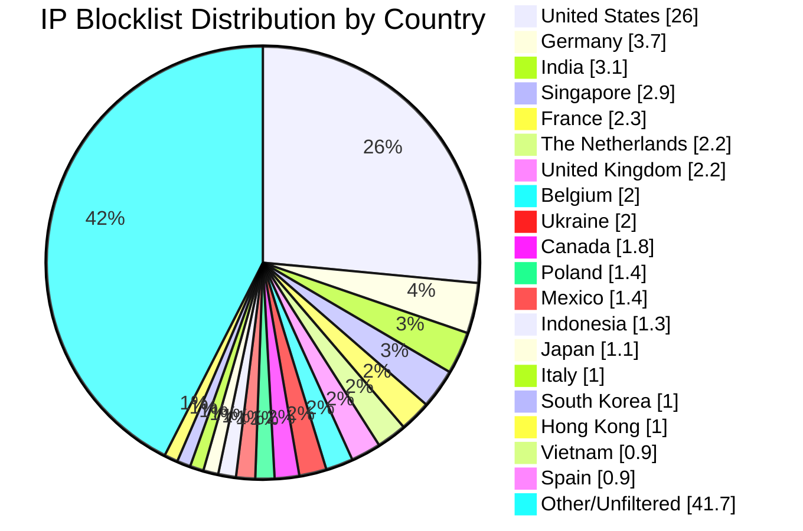

# Multi-Country IP Address Internet Blocklist Aggregator


          


* * *

Automated IP blocklist aggregation with multi-country geographical filtering

* * *

## 🚀 Features

- **Multi-Country Support**: Filter IPs from multiple countries - aggregate or individual lists
- **Automated Aggregation**: Combines multiple IP blocklists into a single deduplicated list
- **Geographical Filtering**: Filters IPs by country with support for multiple countries
- **Individual & Combined Files**: Generates both per-country files and combined multi-country files
- **Docker Support**: Runs in containerized environment for consistency
- **GitHub Actions**: Automated daily updates with manual trigger support
- **Multi-source**: Supports multiple URL sources via environment configuration
- **Enhanced Statistics**: Comprehensive reporting with per-country breakdowns

## 📊 Latest Statistics

**Last Updated:** 2026-11-23 10:58:10 UTC

## 📈 Country Distribution



## Overall Summary

- **Total Input IPs:** 1,021,764
- **Countries Processed:** 82
- **Combined Unique IPs:** 707,770
- **Combined Output File:** `aggregated-multi-82countries-combined.txt`
- **Overall Filter Rate:** 69.27%

## Per-Country Results

| Country | Code | Networks Found | Networks Optimized | IPs Matched | Filter Rate | Output File |
|---------|------|----------------|--------------------|-----------|-----------|-----------|
| Albania | AL | 398 | 398 | 1,059 | 0.10% | `aggregated-al-only.txt` |
| Armenia | AM | 385 | 385 | 1,074 | 0.11% | `aggregated-am-only.txt` |
| Austria | AT | 4,648 | 4,639 | 904 | 0.09% | `aggregated-at-only.txt` |
| Australia | AU | 11,856 | 11,786 | 6,569 | 0.64% | `aggregated-au-only.txt` |
| Azerbaijan | AZ | 432 | 428 | 2,107 | 0.21% | `aggregated-az-only.txt` |
| Barbados | BB | 198 | 198 | 177 | 0.02% | `aggregated-bb-only.txt` |
| Belgium | BE | 5,811 | 5,809 | 20,766 | 2.03% | `aggregated-be-only.txt` |
| Bulgaria | BG | 2,392 | 2,378 | 1,684 | 0.16% | `aggregated-bg-only.txt` |
| Bermuda | BM | 350 | 350 | 21 | 0.00% | `aggregated-bm-only.txt` |
| Brunei | BN | 128 | 128 | 46 | 0.00% | `aggregated-bn-only.txt` |
| Belarus | BY | 467 | 467 | 854 | 0.08% | `aggregated-by-only.txt` |
| Canada | CA | 17,849 | 17,727 | 18,325 | 1.79% | `aggregated-ca-only.txt` |
| Switzerland | CH | 6,681 | 6,558 | 3,021 | 0.30% | `aggregated-ch-only.txt` |
| Cameroon | CM | 194 | 194 | 211 | 0.02% | `aggregated-cm-only.txt` |
| Cyprus | CY | 884 | 884 | 393 | 0.04% | `aggregated-cy-only.txt` |
| Czechia | CZ | 3,807 | 3,805 | 1,565 | 0.15% | `aggregated-cz-only.txt` |
| Germany | DE | 30,809 | 30,705 | 38,180 | 3.74% | `aggregated-de-only.txt` |
| Denmark | DK | 3,988 | 3,981 | 764 | 0.07% | `aggregated-dk-only.txt` |
| Estonia | EE | 1,150 | 1,150 | 397 | 0.04% | `aggregated-ee-only.txt` |
| Egypt | EG | 800 | 800 | 2,477 | 0.24% | `aggregated-eg-only.txt` |
| Spain | ES | 11,794 | 11,775 | 8,817 | 0.86% | `aggregated-es-only.txt` |
| Finland | FI | 3,591 | 3,585 | 3,346 | 0.33% | `aggregated-fi-only.txt` |
| France | FR | 33,764 | 33,733 | 23,121 | 2.26% | `aggregated-fr-only.txt` |
| United Kingdom | GB | 36,853 | 36,697 | 22,202 | 2.17% | `aggregated-gb-only.txt` |
| Georgia | GE | 487 | 486 | 818 | 0.08% | `aggregated-ge-only.txt` |
| Ghana | GH | 373 | 373 | 423 | 0.04% | `aggregated-gh-only.txt` |
| Gibraltar | GI | 165 | 165 | 1 | 0.00% | `aggregated-gi-only.txt` |
| Greece | GR | 1,577 | 1,574 | 800 | 0.08% | `aggregated-gr-only.txt` |
| Hong Kong | HK | 11,344 | 11,324 | 9,840 | 0.96% | `aggregated-hk-only.txt` |
| Croatia | HR | 860 | 860 | 392 | 0.04% | `aggregated-hr-only.txt` |
| Hungary | HU | 1,859 | 1,858 | 1,053 | 0.10% | `aggregated-hu-only.txt` |
| Indonesia | ID | 6,879 | 6,858 | 13,738 | 1.34% | `aggregated-id-only.txt` |
| Ireland | IE | 5,224 | 5,220 | 5,589 | 0.55% | `aggregated-ie-only.txt` |
| Israel | IL | 2,537 | 2,535 | 5,131 | 0.50% | `aggregated-il-only.txt` |
| India | IN | 13,799 | 13,774 | 31,870 | 3.12% | `aggregated-in-only.txt` |
| Iceland | IS | 400 | 400 | 164 | 0.02% | `aggregated-is-only.txt` |
| Italy | IT | 10,117 | 10,080 | 10,307 | 1.01% | `aggregated-it-only.txt` |
| Japan | JP | 12,609 | 12,558 | 11,023 | 1.08% | `aggregated-jp-only.txt` |
| Kenya | KE | 934 | 934 | 2,907 | 0.28% | `aggregated-ke-only.txt` |
| Kyrgyzstan | KG | 262 | 262 | 507 | 0.05% | `aggregated-kg-only.txt` |
| South Korea | KR | 4,056 | 4,047 | 10,306 | 1.01% | `aggregated-kr-only.txt` |
| Kuwait | KW | 476 | 476 | 382 | 0.04% | `aggregated-kw-only.txt` |
| Cayman Islands | KY | 157 | 157 | 16 | 0.00% | `aggregated-ky-only.txt` |
| Kazakhstan | KZ | 1,378 | 1,377 | 2,408 | 0.24% | `aggregated-kz-only.txt` |
| Laos | LA | 167 | 167 | 204 | 0.02% | `aggregated-la-only.txt` |
| Liechtenstein | LI | 384 | 384 | 41 | 0.00% | `aggregated-li-only.txt` |
| Lithuania | LT | 1,528 | 1,527 | 796 | 0.08% | `aggregated-lt-only.txt` |
| Luxembourg | LU | 1,549 | 1,549 | 235 | 0.02% | `aggregated-lu-only.txt` |
| Latvia | LV | 1,261 | 1,261 | 741 | 0.07% | `aggregated-lv-only.txt` |
| Moldova | MD | 804 | 803 | 1,078 | 0.11% | `aggregated-md-only.txt` |
| Macao | MO | 123 | 123 | 139 | 0.01% | `aggregated-mo-only.txt` |
| Malta | MT | 319 | 319 | 305 | 0.03% | `aggregated-mt-only.txt` |
| Mexico | MX | 4,451 | 4,444 | 14,237 | 1.39% | `aggregated-mx-only.txt` |
| Malaysia | MY | 2,720 | 2,720 | 5,509 | 0.54% | `aggregated-my-only.txt` |
| Nigeria | NG | 1,195 | 1,195 | 1,187 | 0.12% | `aggregated-ng-only.txt` |
| The Netherlands | NL | 19,221 | 19,122 | 22,912 | 2.24% | `aggregated-nl-only.txt` |
| Norway | NO | 3,285 | 3,284 | 747 | 0.07% | `aggregated-no-only.txt` |
| Nepal | NP | 473 | 473 | 1,733 | 0.17% | `aggregated-np-only.txt` |
| New Zealand | NZ | 2,363 | 2,349 | 598 | 0.06% | `aggregated-nz-only.txt` |
| Philippines | PH | 2,254 | 2,253 | 4,286 | 0.42% | `aggregated-ph-only.txt` |
| Poland | PL | 8,541 | 8,513 | 14,389 | 1.41% | `aggregated-pl-only.txt` |
| Portugal | PT | 2,107 | 2,105 | 2,795 | 0.27% | `aggregated-pt-only.txt` |
| Qatar | QA | 499 | 499 | 1,525 | 0.15% | `aggregated-qa-only.txt` |
| Romania | RO | 4,161 | 4,150 | 2,341 | 0.23% | `aggregated-ro-only.txt` |
| Serbia | RS | 1,033 | 1,033 | 961 | 0.09% | `aggregated-rs-only.txt` |
| Saudi Arabia | SA | 1,825 | 1,825 | 3,093 | 0.30% | `aggregated-sa-only.txt` |
| Sweden | SE | 10,373 | 10,364 | 5,068 | 0.50% | `aggregated-se-only.txt` |
| Singapore | SG | 9,895 | 9,883 | 29,943 | 2.93% | `aggregated-sg-only.txt` |
| Slovenia | SI | 1,088 | 1,086 | 229 | 0.02% | `aggregated-si-only.txt` |
| Slovakia | SK | 1,203 | 1,202 | 466 | 0.05% | `aggregated-sk-only.txt` |
| Thailand | TH | 2,112 | 2,112 | 4,482 | 0.44% | `aggregated-th-only.txt` |
| Tajikistan | TJ | 161 | 161 | 220 | 0.02% | `aggregated-tj-only.txt` |
| Türkiye | TR | 3,618 | 3,591 | 8,680 | 0.85% | `aggregated-tr-only.txt` |
| Taiwan | TW | 2,538 | 2,538 | 8,747 | 0.86% | `aggregated-tw-only.txt` |
| Ukraine | UA | 5,421 | 5,379 | 20,707 | 2.03% | `aggregated-ua-only.txt` |
| Uganda | UG | 254 | 254 | 338 | 0.03% | `aggregated-ug-only.txt` |
| United States | US | 131,096 | 129,226 | 265,520 | 25.99% | `aggregated-us-only.txt` |
| British Virgin Islands | VG | 309 | 309 | 41 | 0.00% | `aggregated-vg-only.txt` |
| Vietnam | VN | 2,294 | 2,294 | 9,662 | 0.95% | `aggregated-vn-only.txt` |
| South Africa | ZA | 4,009 | 3,996 | 7,548 | 0.74% | `aggregated-za-only.txt` |
| Zambia | ZM | 179 | 179 | 191 | 0.02% | `aggregated-zm-only.txt` |
| Zimbabwe | ZW | 249 | 249 | 321 | 0.03% | `aggregated-zw-only.txt` |

## IP Sources

- **Source 1:** https://raw.githubusercontent.com/firehol/blocklist-ipsets/master/firehol_level1.netset
- **Source 2:** https://raw.githubusercontent.com/firehol/blocklist-ipsets/master/firehol_level2.netset
- **Source 3:** https://rules.emergingthreats.net/fwrules/emerging-Block-IPs.txt
- **Source 4:** https://raw.githubusercontent.com/borestad/blocklist-abuseipdb/main/abuseipdb-s100-30d.ipv4
- **Source 6:** https://raw.githubusercontent.com/stamparm/ipsum/master/levels/3.txt
- **Source 7:** https://www.spamhaus.org/drop/drop.txt
- **Source 9:** https://raw.githubusercontent.com/romainmarcoux/malicious-ip/refs/heads/main/full-300k-aa.txt
- **Source 10:** https://raw.githubusercontent.com/romainmarcoux/malicious-ip/refs/heads/main/full-300k-ab.txt
- **Source 11:** https://raw.githubusercontent.com/romainmarcoux/malicious-ip/refs/heads/main/full-300k-ac.txt
- **Source 12:** https://raw.githubusercontent.com/romainmarcoux/malicious-ip/refs/heads/main/full-300k-ad.txt
- **Source 13:** https://check.torproject.org/torbulkexitlist
- **Source 14:** https://cinsscore.com/list/ci-badguys.txt
- **Source 23:** https://raw.githubusercontent.com/firehol/blocklist-ipsets/master/firehol_level3.netset

## Configuration Details


### 📁 Generated Files

Every file is on the [blocklists release](https://github.com/MarcusHoltz/ipblocklist-geofiltered-aggregator/releases/tag/blocklists), replaced on every run.

- **[`aggregated.txt`](https://github.com/MarcusHoltz/ipblocklist-geofiltered-aggregator/releases/download/blocklists/aggregated.txt)** - 1,021,764 total aggregated IPs from all sources
- **[`aggregated-al-only.txt`](https://github.com/MarcusHoltz/ipblocklist-geofiltered-aggregator/releases/download/blocklists/aggregated-al-only.txt)** - 1,059 IPs from AL
- **[`aggregated-am-only.txt`](https://github.com/MarcusHoltz/ipblocklist-geofiltered-aggregator/releases/download/blocklists/aggregated-am-only.txt)** - 1,074 IPs from AM
- **[`aggregated-at-only.txt`](https://github.com/MarcusHoltz/ipblocklist-geofiltered-aggregator/releases/download/blocklists/aggregated-at-only.txt)** - 904 IPs from AT
- **[`aggregated-au-only.txt`](https://github.com/MarcusHoltz/ipblocklist-geofiltered-aggregator/releases/download/blocklists/aggregated-au-only.txt)** - 6,569 IPs from AU
- **[`aggregated-az-only.txt`](https://github.com/MarcusHoltz/ipblocklist-geofiltered-aggregator/releases/download/blocklists/aggregated-az-only.txt)** - 2,107 IPs from AZ
- **[`aggregated-bb-only.txt`](https://github.com/MarcusHoltz/ipblocklist-geofiltered-aggregator/releases/download/blocklists/aggregated-bb-only.txt)** - 177 IPs from BB
- **[`aggregated-be-only.txt`](https://github.com/MarcusHoltz/ipblocklist-geofiltered-aggregator/releases/download/blocklists/aggregated-be-only.txt)** - 20,766 IPs from BE
- **[`aggregated-bg-only.txt`](https://github.com/MarcusHoltz/ipblocklist-geofiltered-aggregator/releases/download/blocklists/aggregated-bg-only.txt)** - 1,684 IPs from BG
- **[`aggregated-bm-only.txt`](https://github.com/MarcusHoltz/ipblocklist-geofiltered-aggregator/releases/download/blocklists/aggregated-bm-only.txt)** - 21 IPs from BM
- **[`aggregated-bn-only.txt`](https://github.com/MarcusHoltz/ipblocklist-geofiltered-aggregator/releases/download/blocklists/aggregated-bn-only.txt)** - 46 IPs from BN
- **[`aggregated-by-only.txt`](https://github.com/MarcusHoltz/ipblocklist-geofiltered-aggregator/releases/download/blocklists/aggregated-by-only.txt)** - 854 IPs from BY
- **[`aggregated-ca-only.txt`](https://github.com/MarcusHoltz/ipblocklist-geofiltered-aggregator/releases/download/blocklists/aggregated-ca-only.txt)** - 18,325 IPs from CA
- **[`aggregated-ch-only.txt`](https://github.com/MarcusHoltz/ipblocklist-geofiltered-aggregator/releases/download/blocklists/aggregated-ch-only.txt)** - 3,021 IPs from CH
- **[`aggregated-cm-only.txt`](https://github.com/MarcusHoltz/ipblocklist-geofiltered-aggregator/releases/download/blocklists/aggregated-cm-only.txt)** - 211 IPs from CM
- **[`aggregated-cy-only.txt`](https://github.com/MarcusHoltz/ipblocklist-geofiltered-aggregator/releases/download/blocklists/aggregated-cy-only.txt)** - 393 IPs from CY
- **[`aggregated-cz-only.txt`](https://github.com/MarcusHoltz/ipblocklist-geofiltered-aggregator/releases/download/blocklists/aggregated-cz-only.txt)** - 1,565 IPs from CZ
- **[`aggregated-de-only.txt`](https://github.com/MarcusHoltz/ipblocklist-geofiltered-aggregator/releases/download/blocklists/aggregated-de-only.txt)** - 38,180 IPs from DE
- **[`aggregated-dk-only.txt`](https://github.com/MarcusHoltz/ipblocklist-geofiltered-aggregator/releases/download/blocklists/aggregated-dk-only.txt)** - 764 IPs from DK
- **[`aggregated-ee-only.txt`](https://github.com/MarcusHoltz/ipblocklist-geofiltered-aggregator/releases/download/blocklists/aggregated-ee-only.txt)** - 397 IPs from EE
- **[`aggregated-eg-only.txt`](https://github.com/MarcusHoltz/ipblocklist-geofiltered-aggregator/releases/download/blocklists/aggregated-eg-only.txt)** - 2,477 IPs from EG
- **[`aggregated-es-only.txt`](https://github.com/MarcusHoltz/ipblocklist-geofiltered-aggregator/releases/download/blocklists/aggregated-es-only.txt)** - 8,817 IPs from ES
- **[`aggregated-fi-only.txt`](https://github.com/MarcusHoltz/ipblocklist-geofiltered-aggregator/releases/download/blocklists/aggregated-fi-only.txt)** - 3,346 IPs from FI
- **[`aggregated-fr-only.txt`](https://github.com/MarcusHoltz/ipblocklist-geofiltered-aggregator/releases/download/blocklists/aggregated-fr-only.txt)** - 23,121 IPs from FR
- **[`aggregated-gb-only.txt`](https://github.com/MarcusHoltz/ipblocklist-geofiltered-aggregator/releases/download/blocklists/aggregated-gb-only.txt)** - 22,202 IPs from GB
- **[`aggregated-ge-only.txt`](https://github.com/MarcusHoltz/ipblocklist-geofiltered-aggregator/releases/download/blocklists/aggregated-ge-only.txt)** - 818 IPs from GE
- **[`aggregated-gh-only.txt`](https://github.com/MarcusHoltz/ipblocklist-geofiltered-aggregator/releases/download/blocklists/aggregated-gh-only.txt)** - 423 IPs from GH
- **[`aggregated-gi-only.txt`](https://github.com/MarcusHoltz/ipblocklist-geofiltered-aggregator/releases/download/blocklists/aggregated-gi-only.txt)** - 1 IPs from GI
- **[`aggregated-gr-only.txt`](https://github.com/MarcusHoltz/ipblocklist-geofiltered-aggregator/releases/download/blocklists/aggregated-gr-only.txt)** - 800 IPs from GR
- **[`aggregated-hk-only.txt`](https://github.com/MarcusHoltz/ipblocklist-geofiltered-aggregator/releases/download/blocklists/aggregated-hk-only.txt)** - 9,840 IPs from HK
- **[`aggregated-hr-only.txt`](https://github.com/MarcusHoltz/ipblocklist-geofiltered-aggregator/releases/download/blocklists/aggregated-hr-only.txt)** - 392 IPs from HR
- **[`aggregated-hu-only.txt`](https://github.com/MarcusHoltz/ipblocklist-geofiltered-aggregator/releases/download/blocklists/aggregated-hu-only.txt)** - 1,053 IPs from HU
- **[`aggregated-id-only.txt`](https://github.com/MarcusHoltz/ipblocklist-geofiltered-aggregator/releases/download/blocklists/aggregated-id-only.txt)** - 13,738 IPs from ID
- **[`aggregated-ie-only.txt`](https://github.com/MarcusHoltz/ipblocklist-geofiltered-aggregator/releases/download/blocklists/aggregated-ie-only.txt)** - 5,589 IPs from IE
- **[`aggregated-il-only.txt`](https://github.com/MarcusHoltz/ipblocklist-geofiltered-aggregator/releases/download/blocklists/aggregated-il-only.txt)** - 5,131 IPs from IL
- **[`aggregated-in-only.txt`](https://github.com/MarcusHoltz/ipblocklist-geofiltered-aggregator/releases/download/blocklists/aggregated-in-only.txt)** - 31,870 IPs from IN
- **[`aggregated-is-only.txt`](https://github.com/MarcusHoltz/ipblocklist-geofiltered-aggregator/releases/download/blocklists/aggregated-is-only.txt)** - 164 IPs from IS
- **[`aggregated-it-only.txt`](https://github.com/MarcusHoltz/ipblocklist-geofiltered-aggregator/releases/download/blocklists/aggregated-it-only.txt)** - 10,307 IPs from IT
- **[`aggregated-jp-only.txt`](https://github.com/MarcusHoltz/ipblocklist-geofiltered-aggregator/releases/download/blocklists/aggregated-jp-only.txt)** - 11,023 IPs from JP
- **[`aggregated-ke-only.txt`](https://github.com/MarcusHoltz/ipblocklist-geofiltered-aggregator/releases/download/blocklists/aggregated-ke-only.txt)** - 2,907 IPs from KE
- **[`aggregated-kg-only.txt`](https://github.com/MarcusHoltz/ipblocklist-geofiltered-aggregator/releases/download/blocklists/aggregated-kg-only.txt)** - 507 IPs from KG
- **[`aggregated-kr-only.txt`](https://github.com/MarcusHoltz/ipblocklist-geofiltered-aggregator/releases/download/blocklists/aggregated-kr-only.txt)** - 10,306 IPs from KR
- **[`aggregated-kw-only.txt`](https://github.com/MarcusHoltz/ipblocklist-geofiltered-aggregator/releases/download/blocklists/aggregated-kw-only.txt)** - 382 IPs from KW
- **[`aggregated-ky-only.txt`](https://github.com/MarcusHoltz/ipblocklist-geofiltered-aggregator/releases/download/blocklists/aggregated-ky-only.txt)** - 16 IPs from KY
- **[`aggregated-kz-only.txt`](https://github.com/MarcusHoltz/ipblocklist-geofiltered-aggregator/releases/download/blocklists/aggregated-kz-only.txt)** - 2,408 IPs from KZ
- **[`aggregated-la-only.txt`](https://github.com/MarcusHoltz/ipblocklist-geofiltered-aggregator/releases/download/blocklists/aggregated-la-only.txt)** - 204 IPs from LA
- **[`aggregated-li-only.txt`](https://github.com/MarcusHoltz/ipblocklist-geofiltered-aggregator/releases/download/blocklists/aggregated-li-only.txt)** - 41 IPs from LI
- **[`aggregated-lt-only.txt`](https://github.com/MarcusHoltz/ipblocklist-geofiltered-aggregator/releases/download/blocklists/aggregated-lt-only.txt)** - 796 IPs from LT
- **[`aggregated-lu-only.txt`](https://github.com/MarcusHoltz/ipblocklist-geofiltered-aggregator/releases/download/blocklists/aggregated-lu-only.txt)** - 235 IPs from LU
- **[`aggregated-lv-only.txt`](https://github.com/MarcusHoltz/ipblocklist-geofiltered-aggregator/releases/download/blocklists/aggregated-lv-only.txt)** - 741 IPs from LV
- **[`aggregated-md-only.txt`](https://github.com/MarcusHoltz/ipblocklist-geofiltered-aggregator/releases/download/blocklists/aggregated-md-only.txt)** - 1,078 IPs from MD
- **[`aggregated-mo-only.txt`](https://github.com/MarcusHoltz/ipblocklist-geofiltered-aggregator/releases/download/blocklists/aggregated-mo-only.txt)** - 139 IPs from MO
- **[`aggregated-mt-only.txt`](https://github.com/MarcusHoltz/ipblocklist-geofiltered-aggregator/releases/download/blocklists/aggregated-mt-only.txt)** - 305 IPs from MT
- **[`aggregated-mx-only.txt`](https://github.com/MarcusHoltz/ipblocklist-geofiltered-aggregator/releases/download/blocklists/aggregated-mx-only.txt)** - 14,237 IPs from MX
- **[`aggregated-my-only.txt`](https://github.com/MarcusHoltz/ipblocklist-geofiltered-aggregator/releases/download/blocklists/aggregated-my-only.txt)** - 5,509 IPs from MY
- **[`aggregated-ng-only.txt`](https://github.com/MarcusHoltz/ipblocklist-geofiltered-aggregator/releases/download/blocklists/aggregated-ng-only.txt)** - 1,187 IPs from NG
- **[`aggregated-nl-only.txt`](https://github.com/MarcusHoltz/ipblocklist-geofiltered-aggregator/releases/download/blocklists/aggregated-nl-only.txt)** - 22,912 IPs from NL
- **[`aggregated-no-only.txt`](https://github.com/MarcusHoltz/ipblocklist-geofiltered-aggregator/releases/download/blocklists/aggregated-no-only.txt)** - 747 IPs from NO
- **[`aggregated-np-only.txt`](https://github.com/MarcusHoltz/ipblocklist-geofiltered-aggregator/releases/download/blocklists/aggregated-np-only.txt)** - 1,733 IPs from NP
- **[`aggregated-nz-only.txt`](https://github.com/MarcusHoltz/ipblocklist-geofiltered-aggregator/releases/download/blocklists/aggregated-nz-only.txt)** - 598 IPs from NZ
- **[`aggregated-ph-only.txt`](https://github.com/MarcusHoltz/ipblocklist-geofiltered-aggregator/releases/download/blocklists/aggregated-ph-only.txt)** - 4,286 IPs from PH
- **[`aggregated-pl-only.txt`](https://github.com/MarcusHoltz/ipblocklist-geofiltered-aggregator/releases/download/blocklists/aggregated-pl-only.txt)** - 14,389 IPs from PL
- **[`aggregated-pt-only.txt`](https://github.com/MarcusHoltz/ipblocklist-geofiltered-aggregator/releases/download/blocklists/aggregated-pt-only.txt)** - 2,795 IPs from PT
- **[`aggregated-qa-only.txt`](https://github.com/MarcusHoltz/ipblocklist-geofiltered-aggregator/releases/download/blocklists/aggregated-qa-only.txt)** - 1,525 IPs from QA
- **[`aggregated-ro-only.txt`](https://github.com/MarcusHoltz/ipblocklist-geofiltered-aggregator/releases/download/blocklists/aggregated-ro-only.txt)** - 2,341 IPs from RO
- **[`aggregated-rs-only.txt`](https://github.com/MarcusHoltz/ipblocklist-geofiltered-aggregator/releases/download/blocklists/aggregated-rs-only.txt)** - 961 IPs from RS
- **[`aggregated-sa-only.txt`](https://github.com/MarcusHoltz/ipblocklist-geofiltered-aggregator/releases/download/blocklists/aggregated-sa-only.txt)** - 3,093 IPs from SA
- **[`aggregated-se-only.txt`](https://github.com/MarcusHoltz/ipblocklist-geofiltered-aggregator/releases/download/blocklists/aggregated-se-only.txt)** - 5,068 IPs from SE
- **[`aggregated-sg-only.txt`](https://github.com/MarcusHoltz/ipblocklist-geofiltered-aggregator/releases/download/blocklists/aggregated-sg-only.txt)** - 29,943 IPs from SG
- **[`aggregated-si-only.txt`](https://github.com/MarcusHoltz/ipblocklist-geofiltered-aggregator/releases/download/blocklists/aggregated-si-only.txt)** - 229 IPs from SI
- **[`aggregated-sk-only.txt`](https://github.com/MarcusHoltz/ipblocklist-geofiltered-aggregator/releases/download/blocklists/aggregated-sk-only.txt)** - 466 IPs from SK
- **[`aggregated-th-only.txt`](https://github.com/MarcusHoltz/ipblocklist-geofiltered-aggregator/releases/download/blocklists/aggregated-th-only.txt)** - 4,482 IPs from TH
- **[`aggregated-tj-only.txt`](https://github.com/MarcusHoltz/ipblocklist-geofiltered-aggregator/releases/download/blocklists/aggregated-tj-only.txt)** - 220 IPs from TJ
- **[`aggregated-tr-only.txt`](https://github.com/MarcusHoltz/ipblocklist-geofiltered-aggregator/releases/download/blocklists/aggregated-tr-only.txt)** - 8,680 IPs from TR
- **[`aggregated-tw-only.txt`](https://github.com/MarcusHoltz/ipblocklist-geofiltered-aggregator/releases/download/blocklists/aggregated-tw-only.txt)** - 8,747 IPs from TW
- **[`aggregated-ua-only.txt`](https://github.com/MarcusHoltz/ipblocklist-geofiltered-aggregator/releases/download/blocklists/aggregated-ua-only.txt)** - 20,707 IPs from UA
- **[`aggregated-ug-only.txt`](https://github.com/MarcusHoltz/ipblocklist-geofiltered-aggregator/releases/download/blocklists/aggregated-ug-only.txt)** - 338 IPs from UG
- **[`aggregated-us-only.txt`](https://github.com/MarcusHoltz/ipblocklist-geofiltered-aggregator/releases/download/blocklists/aggregated-us-only.txt)** - 265,520 IPs from US
- **[`aggregated-vg-only.txt`](https://github.com/MarcusHoltz/ipblocklist-geofiltered-aggregator/releases/download/blocklists/aggregated-vg-only.txt)** - 41 IPs from VG
- **[`aggregated-vn-only.txt`](https://github.com/MarcusHoltz/ipblocklist-geofiltered-aggregator/releases/download/blocklists/aggregated-vn-only.txt)** - 9,662 IPs from VN
- **[`aggregated-za-only.txt`](https://github.com/MarcusHoltz/ipblocklist-geofiltered-aggregator/releases/download/blocklists/aggregated-za-only.txt)** - 7,548 IPs from ZA
- **[`aggregated-zm-only.txt`](https://github.com/MarcusHoltz/ipblocklist-geofiltered-aggregator/releases/download/blocklists/aggregated-zm-only.txt)** - 191 IPs from ZM
- **[`aggregated-zw-only.txt`](https://github.com/MarcusHoltz/ipblocklist-geofiltered-aggregator/releases/download/blocklists/aggregated-zw-only.txt)** - 321 IPs from ZW
- **[`aggregated-multi-82countries-combined.txt`](https://github.com/MarcusHoltz/ipblocklist-geofiltered-aggregator/releases/download/blocklists/aggregated-multi-82countries-combined.txt)** - 707,770 unique IPs (deduplicated across all countries)
- **[`geo_allow.txt`](https://github.com/MarcusHoltz/ipblocklist-geofiltered-aggregator/releases/download/blocklists/geo_allow.txt)** - 135,624 ranges covering every configured country
- **[`allow_ops.txt`](https://github.com/MarcusHoltz/ipblocklist-geofiltered-aggregator/releases/download/blocklists/allow_ops.txt)** - Stripe webhook sender addresses
- **[`bl_single.txt`](https://github.com/MarcusHoltz/ipblocklist-geofiltered-aggregator/releases/download/blocklists/bl_single.txt)** - 671,300 single addresses from the combined file
- **[`bl_range.txt`](https://github.com/MarcusHoltz/ipblocklist-geofiltered-aggregator/releases/download/blocklists/bl_range.txt)** - 36,470 ranges from the combined file
- **[`SHA256SUMS`](https://github.com/MarcusHoltz/ipblocklist-geofiltered-aggregator/releases/download/blocklists/SHA256SUMS)** - checksums of the four files above
- **[`country-samples.tsv`](https://github.com/MarcusHoltz/ipblocklist-geofiltered-aggregator/releases/download/blocklists/country-samples.tsv)** - addresses the every-country check tested

---

## 🛴 Install

Set up your own copy of this repository to aggregate and filter your IP blocklists for multiple countries.

* * *

### 👆 Click the green "Use this template" button in the upper right corner

         
1. **Sign in** to GitHub and navigate to [this repository](https://github.com/MarcusHoltz/ipblocklist-geofiltered-aggregator).
2. Click the **"Use this template"** button (in the upper right corner).
3. Select **Create a new repository**. Enter a name (e.g., `my-eu-badip-blocklist`), and confirm.
4. Your new repository is now independent — it will not share commit history with the original.
5. You can immediately begin editing or configuring it for your own multi-country IP aggregation project.

> The **"Use this template"** button on GitHub allows you to quickly create a new, independent repository pre-populated with the project's files and structure. Your new repository won't inherit commit history from the template. This is perfect for your personal blocklist repo.

*Usage is below for steps on running this repository with Github Actions in your new IP aggregation project.*


## 🛠 Usage

### GitHub Actions (Recommended)

#### First Step - Enable Write Permissions

1. **Enable Actions**: Go to Settings > Actions > General > Workflow permissions
2. **Set Permissions**: Select "Read and write permissions", click "Save".


#### Second Step - Configure The Repo

3. **Configure Environment**: Edit `.env` file with your desired sources and countries
4. **Your Favorite Blocklists**: Load as many blocklists as you like, just make sure the line starts with `LIST1_`, `LIST2_`, `LIST3_`, etc.
5. **Multiple Countries**: Countries can be modified the same way, `COUNTRY_ISO_CODE_1`, `COUNTRY_NAME_1`, `COUNTRY_ISO_CODE_2`, `COUNTRY_NAME_2`, etc.
6. **Find Country Codes**: You can find your country codes in the [geoip2-ipv4 spreadsheet](https://datahub.io/core/geoip2-ipv4)
7. **Automatic Runs**: The workflow runs twice daily. At both **02:17 AM/PM UTC** or it will run anytime if you [modified the cron file](https://github.com/MarcusHoltz/ipblocklist-geofiltered-aggregator/edit/main/.github/workflows/ip-aggregation.yml)


#### Third Step - Running This Action

8. **Run This Now**: You can run this Github Action by using the "Action" tab up top
9. **Generate Multi-Country Blocklists**: Under "All workflows" you can find this action
10. **Run workflow**: On this page, off to the right is a button with a dropdown to "Run workflow"
11. **Off to the races**: Each run will consume some of your free monthly Github Actions 2000 min (33.3 hours)

> Please adjust cron, it is how often your aggregator runs in [.github/workflows/ip-aggregation.yml](https://github.com/MarcusHoltz/ipblocklist-geofiltered-aggregator/edit/main/.github/workflows/ip-aggregation.yml), also modify your blacklists and countries in the [.env](https://github.com/MarcusHoltz/ipblocklist-geofiltered-aggregator/edit/main/.env) file.

## ⚙ Configuration

### 🌍 Multi-Country Setup

The `.env` file supports multiple countries:

```bash
# European Union Example
COUNTRY_ISO_CODE_1=DE
COUNTRY_NAME_1=Germany

COUNTRY_ISO_CODE_2=FR
COUNTRY_NAME_2=France

COUNTRY_ISO_CODE_3=NL
COUNTRY_NAME_3=Netherlands

COUNTRY_ISO_CODE_4=IT
COUNTRY_NAME_4=Italy

COUNTRY_ISO_CODE_5=ES
COUNTRY_NAME_5=Spain
```

This will generate:
- `aggregated-de-only.txt` (Germany IPs)
- `aggregated-fr-only.txt` (France IPs) 
- `aggregated-nl-only.txt` (Netherlands IPs)
- `aggregated-it-only.txt` (Italy IPs)
- `aggregated-es-only.txt` (Spain IPs)
- `aggregated-multi-5countries-combined.txt` (All countries combined, deduplicated)

### Sample .env file

```bash
# Add your IP list sources
LIST_1=https://example.com/blocklist1.txt
LIST_2=https://example.com/blocklist2.txt

# Set multiple countries (NEW FEATURE!)
COUNTRY_ISO_CODE_1=DE
COUNTRY_NAME_1=Germany

COUNTRY_ISO_CODE_2=FR  
COUNTRY_NAME_2=France

# Configure paths (usually don't need to change)
GEOIP_CSV_PATH=/data/geoip/geoip2-ipv4.csv
ALL_IPS_FROM_LISTS=/data/output/aggregated.txt
```

## 🏠 Local Deployment (Alternative)

If you'd rather download this repo and run this project offline, the instructions are below:

### 1. Clone the repository

The first step is to download the files from the internet, and get them locally on your machine.

```bash
git clone https://github.com/MarcusHoltz/ipblocklist-geofiltered-aggregator.git
```

### 2. Configure your sources and countries in .env

The next step is to configure the project to your liking. Edit your `.env` file. You can enter as many IP based block lists as you need and configure multiple countries.

```bash
nano .env
```

### 3. Run with Docker Compose

You can now run the project and see what happens.

```bash
docker compose up --build
```

### 4. Check results

Let's see what happened!

```bash
ls -la data/output/
```

## 📁 Output Files

### Per-Country Files
- `data/output/aggregated-{country-code}-only.txt` - Country-specific IPs (e.g., `aggregated-de-only.txt` for Germany)

### Combined Multi-Country Files  
- `data/output/aggregated-multi-{number-of-countries-total}countries-combined.txt` - Combined IPs from all countries (deduplicated)
- Example: `aggregated-multi-3countries-combined.txt` for Germany + France + Netherlands

### Core Files
- `data/output/aggregated.txt` - All deduplicated IPs from all sources (before country filtering)
- `data/output/stats.md` - Comprehensive processing statistics with per-country breakdowns

## 🔄 Workflow Triggers

The GitHub Action runs automatically when:

- **Daily Schedule**: Every day, twice. Once at at 02:17 AM UTC and then again at 02:17 PM UTC
- **File Changes**: When `.env`, `Dockerfile`, or key scripts are modified
- **Manual Trigger**: Via GitHub Actions interface


## ⚡ Performance

- **Multi-Country Processing**: Parallel processing of multiple countries
- **Processing Speed**: ~10,000 IPs per second for filtering per country
- **Parallel Processing**: Multi-core optimization for large datasets  
- **Memory Efficient**: Streaming processing for large files
- **Optimized Lookup**: Integer-based IP range matching with SubnetTree
- **Network Optimization**: Automatic collapsing of overlapping CIDR blocks

## 🌼 Features and Optimizations

- **🌍 Multi-country IP blocklist aggregation** for comprehensive regional security  
- **📊 Per-country statistical analysis** with detailed filtering metrics
- **🔄 Automated multi-country updates** via GitHub Actions
- **🚀 Parallel country processing** for improved performance
- **📁 Individual and combined output files** for flexible deployment
- **🛡️ Regional threat mitigation** with configurable multi-country rules
- **💾 Memory-efficient processing** even with multiple large country datasets
- **🔗 Network optimization** with automatic CIDR block collapsing

## 👍 Acknowledgements

This project would not have been possible without the amazing work of the following other projects:

* * *

### 🎩 Datopian

Thank you to [Datopian](https://github.com/datasets/geoip2-ipv4) for maintaining the [GeoIP2 IPv4 dataset](https://datahub.io/core/geoip2-ipv4). This dataset provides otherwise impossible information for IP geolocation, allowing this project to filter IPs based on multiple countries simultaneously.

- [GeoIP2 IPv4 Dataset](https://datahub.io/core/geoip2-ipv4) by Datopian is essential for filtering and identifying IP addresses across various countries, enabling the dynamic multi-country functionality of this project.


* * *

### 🦘 Andrew Twin

Special thanks to [Andrew Twin](https://github.com/andrewtwin) for creating and sharing the [IP Aggregator](https://github.com/andrewtwin/ip-aggregator) project. Andrew's work on efficiently aggregating IP blocklists was a fundamental inspiration and foundation for this enhanced multi-country version.

- The [IP Aggregator](https://github.com/andrewtwin/ip-aggregator) allows easy downloading, parsing, and filtering of multiple IP blocklists, which this project leverages and extends for multi-country IP management tasks.


* * *

### 📗 Blocklist maintainers

I would like to additionally acknowledge the maintainers and contributors of various [IP blocklists](https://github.com/topics/ip-blocklist) and [IP blacklists](https://github.com/topics/ip-blacklist). Thank you for maintaining up-to-date, community-driven threat intelligence that forms the foundation of generating these multi-country filtered files. While the specific lists in this repo may vary, the collective dedication to improving online security and privacy of all contributors is deeply appreciated.


* * *

